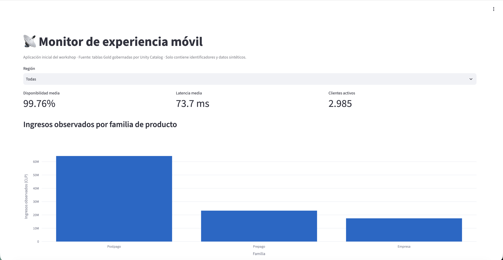

# Monitor de experiencia móvil — plantilla inicial

Databricks App deliberadamente simple para el ejercicio guiado del workshop. La
plantilla tiene una sola página, un filtro de provincia, tres KPI, un gráfico de
productos y una tabla de sitios. Los participantes comprueban así que una App
puede consumir la misma capa Gold utilizada por SQL, el dashboard y Genie sin
tener que diseñar una aplicación completa durante la sesión.

Los datos representan a Equinoccio Móvil, un operador móvil ecuatoriano ficticio, y no incluyen nombres,
cédulas, teléfonos, correos, direcciones ni otros datos personales.



## Contrato de datos

En Databricks la App consume, preferentemente, estas tablas Gold de Unity Catalog:

- `gold_network_hourly`
- `gold_site_daily_360`
- `gold_customer_360`
- `gold_customer_product_daily`
- `gold_incident_impact`

El catálogo, schema, warehouse y nombres alternativos se reciben únicamente por
variables de entorno. No se versionan identificadores de recursos ni credenciales.

| Variable | Obligatoria para modo remoto | Uso |
|---|---:|---|
| `DATABRICKS_WAREHOUSE_ID` | Sí | SQL Warehouse asociado a la App. |
| `TELCO_CATALOG` | Sí | Catálogo que contiene la capa Gold. |
| `TELCO_SCHEMA` | Sí | Schema que contiene la capa Gold. |
| `DATABRICKS_PROFILE` | Solo desarrollo local remoto | Perfil de la CLI; nunca se fija en código. |
| `TELCO_LOCAL_DATA_DIR` | Solo modo local | Directorio con los once CSV sintéticos. |
| `TELCO_APP_ROW_LIMIT` | No | Límite de filas, entre 1.000 y 500.000. |

Los nombres de las cinco tablas se pueden sobrescribir con
`TELCO_TABLE_NETWORK_HOURLY`, `TELCO_TABLE_SITE_DAILY_360`,
`TELCO_TABLE_CUSTOMER_360`, `TELCO_TABLE_CUSTOMER_PRODUCT_DAILY` y
`TELCO_TABLE_INCIDENT_IMPACT`.

## Contingencia local

Sin una configuración remota completa, `data_access.py` lee los CSV sintéticos del
directorio indicado en `TELCO_LOCAL_DATA_DIR` y deriva vistas Gold equivalentes. El
repositorio ya no incluye esos CSV: descárguelos del volume del participante
(`/Volumes/<catálogo>/z2h_<usuario>/raw_data`) si necesita ejecutar la App en un
portátil. En Databricks siempre se usa la capa Gold.

```bash
TELCO_LOCAL_DATA_DIR=<ruta-a-los-csv> streamlit run apps/network-monitor/app.py
```

## Configuración en Databricks Apps

Cada participante crea y despliega **su propia** App con `notebooks/09_app`, que usa
el SDK de Databricks:

1. Crea la App `z2h-<usuario>` con sus recursos: el SQL Warehouse (`CAN_USE`) y las
   cinco tablas Gold (`SELECT`). Declararlos como recursos concede esos permisos al
   service principal de la App.
2. Copia `app.py`, `data_access.py` y `requirements.txt` a
   `/Workspace/Users/<usuario>/z2h_app` y genera allí un `app.yaml` con
   `DATABRICKS_WAREHOUSE_ID` (`valueFrom: sql-warehouse`), `TELCO_CATALOG` y
   `TELCO_SCHEMA` del participante.
3. Despliega esa carpeta y espera a que la App arranque.

Revise `/logz` en la App si activa la contingencia local inesperadamente.

La autenticación remota usa las credenciales inyectadas por Databricks Apps. La
ejecución local remota usa el perfil indicado por `DATABRICKS_PROFILE`; no requiere
ni admite tokens guardados en el repositorio.

## Actividad guiada durante el workshop

1. Ejecute las secciones 1 y 2 de `notebooks/09_app` y abra el enlace de la App.
2. Abra `app.py` en el Git folder e identifique la carga de las tablas Gold.
3. Cambie el título de la página y añada una cuarta métrica sencilla, por ejemplo
   NPS medio o clientes de riesgo alto.
4. Vuelva a ejecutar la sección 2 de `09_app` para redesplegar.
5. Cambie de provincia y verifique la actualización de los KPI.

## Reto final: transformar la plantilla en una App moderna

La plantilla inicial es el punto de partida, no la solución del reto. La ejecución
completa se realiza después del workshop.

### Nivel 1 — estructura y diseño

- Crear navegación con las secciones **Resumen**, **Red**, **Clientes** y
  **Productos**.
- Mover los filtros a una barra lateral y añadir tecnología y segmento.
- Aplicar una jerarquía visual consistente para títulos, KPI y estados.
- Mantener una experiencia legible en pantallas de portátil.

### Nivel 2 — interacción

- Añadir un mapa de sitios coloreado por estado de salud.
- Crear una visualización de riesgo de clientes por segmento.
- Incorporar una vista de ingresos, ARPU o consumo por producto.
- Mostrar estados vacíos y mensajes de error comprensibles.

### Nivel 3 — producto listo para compartir

- Incorporar navegación clara, contexto de filtros y fecha de actualización.
- Aplicar accesibilidad básica: contraste, etiquetas y colores no ambiguos.
- Evitar consultas a Bronze, Silver o archivos CSV en modo remoto.
- Documentar permisos, contingencia y criterio de actualización de datos.

### Criterios de éxito

- La App usa exclusivamente tablas Gold gobernadas por Unity Catalog.
- Los filtros actualizan todos los elementos aplicables.
- Hay por lo menos tres secciones de negocio y cuatro visualizaciones.
- La App no muestra PII, secretos, IDs de infraestructura ni el nombre de una
  operadora real.
- El código mantiene separados el acceso a datos y la presentación.
